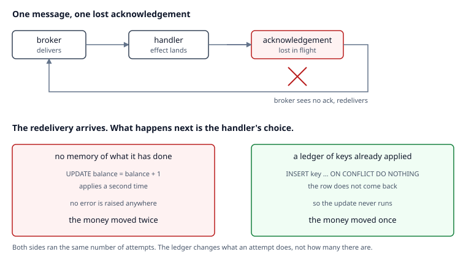

# retry-amplification

**A retry policy is a data corruption policy until the handler is idempotent — and the
corruption factor is the same number as the load multiplier.**

Every queue worth using delivers at least once, which means it sometimes delivers twice.
Every client worth using retries, which means it sometimes applies twice. Those are the
same mechanism seen from opposite ends, and this repository measures both ends of it
against a real PostgreSQL.

The result is one number that is two different outages. At **half the acknowledgements
lost, 1.925x** as many attempts reach the handler, and a handler with no memory of what it
has already done applies its effect **1.925x** as often: **3699 units of money** that
should not exist, with no error raised anywhere.



## The four things this measures

### E1. The two bills are one number

Sweep the acknowledgement loss rate, run the same seeded delivery past both handlers.
The naive handler's balance inflation *is* its attempt count. At **0.75 of
acknowledgements lost** it **inflates the balance 3.066x**, leaving **8262 units that
should not exist** out of **4000 messages**.

<!-- table:e1 -->
```text
  ack lost  attempts  predicted   naive bal  ledger bal  extra units
--------------------------------------------------------------------
      0.00     1.000      1.000        4000        4000            0
      0.10     1.103      1.111        4412        4000          412
      0.25     1.321      1.332        5282        4000         1282
      0.40     1.631      1.650        6522        4000         2522
      0.50     1.925      1.938        7699        4000         3699
      0.60     2.284      2.306        9138        4000         5138
      0.75     3.066      3.051       12262        4000         8262
```
<!-- /table:e1 -->

The ledger column never moves. More to the point, neither does the attempt count: the two
handlers run an identical number of attempts at every loss rate, because a ledger changes
what an attempt *does*, not how many there are.

That is the part worth running the experiment for. Idempotency is widely understood as the
fix for at-least-once delivery, and it is — for the data. For the load it does nothing at
all. A service that added an idempotency ledger and kept falling over was usually sold the
ledger as a fix for both.

### E2. The attempt cap chooses which damage you get

The obvious response to E1 is to turn the retries down, so sweep the cap and watch both
consequences at once.

<!-- table:e2 -->
```text
  cap  attempts  extra units  ledger bal   never acked   predicted
------------------------------------------------------------------
    1     1.000            0        4000       0.49575     0.50000
    2     1.499         1975        4000       0.24600     0.25000
    3     1.745         2983        4000       0.12410     0.12500
    5     1.932         3699        4000       0.03195     0.03125
    8     1.988         3890        4000       0.00455     0.00391
   12     1.997         3947        4000       0.00025     0.00024
```
<!-- /table:e2 -->

With **a cap of 1** there is no corruption at all and **49.6% of messages never
acknowledged** — and every one of those already applied, so a real broker redelivers them
after the visibility timeout and applies them again, outside the window this harness
watches. **Raising it to 12** gets that **down to 0.025%**, which is **5 messages out of**
twenty thousand, and buys **3947 units** that should not exist.

No setting improves both, because they are the same series read from opposite ends. Run
the identical caps past the idempotent handler and the data column stops moving: the cap
goes back to being a decision about load, which is the only kind of decision it should
ever have been.

### E3. What the ledger costs

It is not free. Measured at the statement level, with the three operations interleaved
inside one connection so that machine drift lands on all of them equally, the ledger
**costs 30% on the apply path** and a declined application costs **0.33 of the cost of
performing one**.

Two earlier versions of this measurement were wrong — one pooled operations whose costs
differ by a factor of three, the other tried to resolve a seventh of a millisecond across
whole runs on a two-core box. Both are written up in
[ADR-002](docs/adr/ADR-002-two-measurements-that-were-wrong.md), because the corrections
are more useful than the number.

### E4. Backoff reschedules amplification, it does not reduce it

This is the one that changes what someone does on Monday.

<!-- table:e4 -->
```text
policy                  attempts      wall  extra units   never acked
---------------------------------------------------------------------
immediate                   3828     2.12s         1828        0.0295
exponential_backoff         3828     8.11s         1828        0.0295
budgeted                    2400     1.50s          400        0.3885
```
<!-- /table:e4 -->

Immediate retries and exponential backoff ran **the same 3828 attempts** and caused
exactly the same corruption. Backoff took **3.83x as long** to do it.

That is not a bug in the backoff. The series has no time in it: a message that needs four
attempts needs four attempts whether they arrive in four milliseconds or four minutes.
Backoff is still worth having — it breaks up a thundering herd and gives a struggling
dependency quiet gaps to recover in — but it is not a load reduction, and reaching for it
when a dependency is drowning in retries will not stop the drowning.

A retry budget is the only policy here that cuts attempts, taking them **down to 2400
attempts**. It does that by giving up: it **removes 1428 attempts** by **abandoning 718
messages**, taking the unacknowledged share **from 2.9% never acknowledged** to **38.9%
never acknowledged**. That is the honest shape of the trade. A budget does not make
failure cheaper, it makes failure bounded and visible — which is also what a circuit
breaker does, with the accounting kept per dependency instead of per batch.

## How the numbers are kept honest

The theory comes first. `src/retry_amplification/theory.py` derives the attempt count as a
truncated geometric series from a stated model of the failure, before anything was
measured, and is never fitted to a result. Every experiment re-derives its prediction from
it and compares.

`tools/check_laws.py` then repeats that comparison against the committed results on every
`make verify`, so the published figures stay checkable on hardware that has never run
them. It was run against deliberately corrupted results to confirm it exits non-zero,
rather than trusted to.

`tools/check_numbers.py` matches figures to prose in both directions: every metric must
appear in a document through an anchor phrase, and every decimal in the prose must
correspond to a metric. The tables above are generated from the experiment output and
regenerated by `make verify`, so CI fails if what is committed no longer matches what was
measured.

Tolerances are built from the sample size rather than chosen as percentages. That one was
learned the hard way and is written up in
[ADR-003](docs/adr/ADR-003-the-series-as-the-apparatus-check.md).

## What this cannot measure

Read [ADR-005](docs/adr/ADR-005-what-this-cannot-measure.md) before quoting any figure
from here. The short version:

- The handler's effect and the ledger share a transaction. Most real double-apply bugs
  involve an effect that cannot join your transaction — a payment provider, an email, a
  webhook — and those need a different solution.
- Acknowledgement loss is modelled as independent. Real loss arrives in correlated bursts,
  which leaves the mean amplification alone and changes everything about the tail.
- Attempts are serial. A real worker pool races on the same key, and that contention is
  not measured here.
- The ledger is never pruned. Pruning it to a window shorter than the longest possible
  redelivery reopens the hole silently.

## Running it

```bash
make install
make db-up      # PostgreSQL 16.15, pinned, on port 5433
make verify     # lint, tests, law check, number check — the gate
make bench      # the four experiments, minutes not seconds
```

A single scenario, with the exit code as the interface:

```bash
retry-amplification --handler naive --ack-loss 0.5 --messages 4000
```

| exit | meaning |
| --- | --- |
| 0 | every effect applied exactly once |
| 1 | effects missing: the cap was reached while the handler was still failing |
| 2 | the scenario cannot produce a trustworthy measurement |
| 3 | the measurement did not complete |
| 4 | silent double-apply: money moved twice, every component reported success |
| 5 | the run does not obey the series, so no corruption figure is printed |

Real transcripts, regenerated by `make bench`, are in
[docs/cli-output.md](docs/cli-output.md).

## Layout

```text
src/retry_amplification/
  config.py     scenario validation that refuses untrustworthy runs
  theory.py     the geometric series, written before any measurement
  broker.py     at-least-once delivery with injectable acknowledgement loss
  handlers.py   naive and ledger-backed handlers against real PostgreSQL
  harness.py    one scenario, measured by two independent instruments
  report.py     verdict, plus the refusal to publish a run it does not believe
  cli.py        exit codes
experiments/    the four experiments above
tools/          metric collection, the two checkers, the diagram, the transcripts
docs/adr/       five decision records, including two mistakes and their fixes
```

## How this was built

This repository was built by Murali Marupudi working with Claude, an AI assistant, as a
pair-programming partner. The claim, the experimental design, the decisions about what to
measure and what to throw away, and the judgement calls recorded in the decision records
are the author's. Claude was used for implementation, for argument, and as a second pair
of eyes on the measurements.

Two of the mistakes in [ADR-002](docs/adr/ADR-002-two-measurements-that-were-wrong.md) and
the tolerance error in
[ADR-003](docs/adr/ADR-003-the-series-as-the-apparatus-check.md) were found by looking at
results that had the wrong shape and asking whether they could possibly be true. That
habit is the actual subject of this repository.

## Licence

MIT. See [LICENSE](LICENSE).
